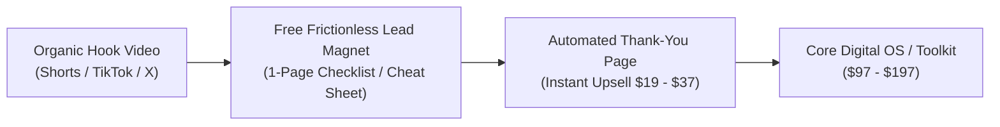

# Video 04: I Only Sell 1 Type of Digital Product (It's Made Me $75M)

- **Original Video Link:** [https://www.youtube.com/watch?v=ooCze6Y6q70](https://www.youtube.com/watch?v=ooCze6Y6q70)
- **Primary Business Model:** High-Leverage Digital Products / Specialized Transformational Systems
- **Target Audience:** Creators, coaches, knowledge workers, digital entrepreneurs
- **Beginner Feasibility Rating:** 6/10 (Building it is easy; driving traffic without an audience is hard)
- **Speed to First Dollar:** 14 – 30 Days (Faster if leveraging organic TikTok/Instagram reels)
- **Startup Capital Required:** $0 – $30 (Gumroad / Stan Store / Canva)

---

## 1. Executive Summary & Core Premise
The creator breaks down the reality behind selling digital products. Most people fail because they sell generic 100-page eBooks or broad info-products that no one asked for. The only digital product that prints millions is a **High-Utility, Specific Solution Framework** (such as specialized workflow operating systems, legal/contract template packs, financial calculators, or plug-and-play SOPs). People do not buy information; they buy speed, certainty, and avoided headaches.

---

## 2. The 3 Tiers of Digital Products
1. **Low Utility (Fails):** Generic eBooks ("How to be Productive", "Beginner Guide to Crypto").
2. **Medium Utility:** Video courses (High customer friction, low completion rates).
3. **High Utility (Prints Money):** 
   - Plug-and-play templates (Notion systems, Figma UI kits, Excel financial models).
   - Done-for-you contract/legal agreement packs for specific freelancers.
   - Ready-to-use prompt libraries that solve a verifiable professional pain point.

---

## 3. The 4-Part Digital Product Funnel

---

## 4. The "Noob" Reality Check (Brutal Truth & Red Flags)
- **The Traffic Illusion:** Putting a product on Gumroad or Etsy does NOT bring buyers automatically. You must either have an organic social media audience or run paid traffic.
- **The $75M Claim:** This scale requires an 8-figure marketing budget, massive email lists, and years of compound branding. For a beginner, a realistic first goal is **$500 to $1,500/month**.

---

## 5. 7-Day Beginner Action Plan
- **Day 1:** Pick an industry you know well or research a high-pain niche (e.g. real estate agents needing social media scripts, or Airbnb hosts needing house guidebooks).
- **Day 2:** Build a 1-page Notion or Canva template that solves this exact problem in 30 minutes.
- **Day 3:** Set up a free account on Gumroad or Stan Store. Connect Stripe.
- **Day 4:** Price the product at $19 to $27.
- **Day 5:** Create 5 TikToks/Reels demonstrating the exact problem and showing the template in action.
- **Day 6:** Direct viewers to your bio link.
- **Day 7:** Engage with all comments and iterate on the hook of your best-performing video.
