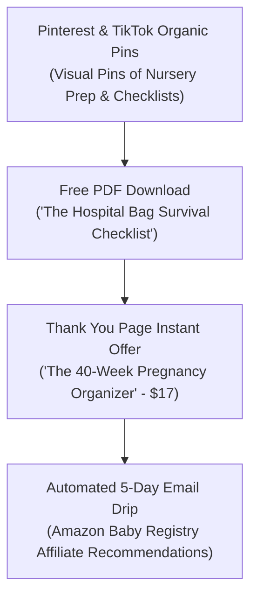

# Video 06: Pregnant Women + Free PDFs = Doctor's Salary ($30k/mo)

- **Original Video Link:** [https://www.youtube.com/watch?v=qF0fiQGrBmI](https://www.youtube.com/watch?v=qF0fiQGrBmI)
- **Primary Business Model:** Hyper-Niche Lead Magnet Funnel + Digital Upsells + Affiliate Marketing
- **Target Audience:** First-time expectant mothers (High urgency, high buying intent)
- **Beginner Feasibility Rating:** 8/10 (Extremely beginner friendly; zero tech complexity)
- **Speed to First Dollar:** 14 – 21 Days
- **Startup Capital Required:** $0 – $20

---

## 1. Executive Summary & Core Premise
The video breaks down an ultra-profitable marketing funnel targeting expectant mothers. Pregnant women, particularly first-time moms, experience immense anxiety, information overload, and a relentless desire to prepare. By offering a free, well-designed PDF checklist (e.g., "The Ultimate Hospital Bag Checklist" or "First Trimester Nutrition Guide"), the creator captures thousands of email leads and instantly funnels them into low-ticket digital bundles and high-ticket baby gear affiliate links.

---

## 2. The 3-Step Monetization Pipeline

- **Front-End Freebie:** 2-page PDF checklist built in Canva.
- **Tripwire Product:** $17 printable pregnancy journal / nursery budget planner.
- **Back-End Affiliate:** Amazon Associates links for baby monitors, strollers, maternity pillows, postpartum care kits (generating 3%–10% commissions).

---

## 3. Why This Works So Well (Psychology)
- **Urgent Countdown Clock:** A pregnancy lasts 9 months; there is a fixed biological deadline that forces action and purchases.
- **High Pinterest Traffic:** Pinterest is the #1 search engine for expectant mothers. Pins live and drive traffic for months, unlike TikToks which die after 48 hours.

---

## 4. The "Noob" Reality Check
- **Medical Disclaimers:** You must include clear disclaimers stating that your materials are for informational purposes and not medical advice.
- **Design Quality:** Expectant moms appreciate aesthetic, clean, pastel-toned design. Use Canva's pre-made pregnancy templates; do not create ugly plain text documents.

---

## 5. 7-Day Beginner Action Plan
- **Day 1:** Open Canva. Search "Pregnancy Checklist" and customize a 2-page "Hospital Bag Essentials Checklist".
- **Day 2:** Create a 15-page "Ultimate First-Time Mom Prep Bundle" priced at $19.
- **Day 3:** Set up a free Gumroad or Stan Store page.
- **Day 4:** Create a Pinterest Business account. Design 10 visual pins linking to your free checklist.
- **Day 5:** Sign up for the Amazon Associates program to get affiliate links for popular nursery items.
- **Day 6:** Set up an automated welcome email in MailerLite (Free up to 1,000 subscribers) sending the free PDF and recommending your favorite 3 baby items.
- **Day 7:** Post 3 pins daily on Pinterest and 1 aesthetic reel on Instagram/TikTok.
