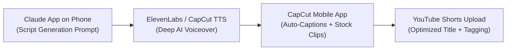

# Video 13: How To Make Faceless YouTube Shorts on Mobile Phone with Claude (Free Prompt/Automation)

- **Original Video Link:** [https://www.youtube.com/watch?v=DeKEUcyNL3c](https://www.youtube.com/watch?v=DeKEUcyNL3c)
- **Primary Business Model:** Automated Faceless Short-Form Content Creation (YouTube Shorts / TikTok / Reels)
- **Target Audience:** Complete beginners, smartphone-only creators, side-hustlers
- **Beginner Feasibility Rating:** 8/10 (Extremely low friction, $0 cost, highly accessible)
- **Speed to First Dollar:** 30 – 60 Days (via AdSense / affiliate links)
- **Startup Capital Required:** $0 (Smartphone + free software tiers)

---

## 1. Executive Summary & Core Premise
The video teaches a 100% mobile, zero-budget production line for creating faceless YouTube Shorts using Anthropic's Claude on a smartphone. The creator shares prompt templates that generate curiosity-driven micro-stories (historical facts, psychological paradoxes, creepy mysteries, daily life stoicism), along with free mobile apps to automate voiceovers, B-roll selection, auto-captions, and background music in under 15 minutes per video.

---

## 2. The 4-Step Mobile Production Line

1. **Step 1: Scripting with Claude:** Using a master prompt:
   > *"Write a 45-second YouTube Shorts script about an untold historical paradox. Start with a 3-second shocking hook. Keep sentences short and conversational. Include visual cues in brackets."*
2. **Step 2: AI Voiceover:** Pasting the script into ElevenLabs (free tier) or CapCut's built-in text-to-speech engine (voice: "Adam" or "Narrator").
3. **Step 3: Visual Assembly in CapCut:**
   - Add royalty-free vertical B-roll from Pexels/Pixabay.
   - Tap "Auto Captions" $\rightarrow$ choose a high-engagement animated preset (yellow/green highlight text).
   - Add ambient, copyright-free background music at 8% volume.
4. **Step 4: Export & Upload:** Export at 1080p, 60fps. Upload directly from the YouTube mobile app.

---

## 3. Monetization Paths for Faceless Shorts
- **YouTube Shorts Partner Program:** Requires 1,000 subscribers and 10M Shorts views in 90 days. Payouts average $0.05 to $0.15 per 1,000 views.
- **Affiliate Bio Link (Faster Cash):** Pin a link in the comments or bio to a relevant ClickBank/Amazon product related to the video topic (e.g., stoic journals, books, niche gadgets).

---

## 4. The "Noob" Reality Check (Brutal Truth)
- **YouTube Shorts AdSense pays very little:** 1 million views on Shorts will only earn you between $40 and $120. Do NOT expect to get rich purely from YouTube Shorts ad revenue.
- **Consistency is Mandatory:** You must post 1 to 2 shorts every single day for 60 consecutive days. If you post 5 videos and give up because they got 40 views, this model will fail you.

---

## 5. 7-Day Beginner Action Plan
- **Day 1:** Install Claude and CapCut on your smartphone.
- **Day 2:** Pick a niche with high retention: "Mind-Bending Science Facts" or "Dark Psychology".
- **Day 3:** Generate 7 scripts using Claude.
- **Day 4:** Produce and edit your first 3 Shorts in CapCut.
- **Day 5:** Create a branded YouTube channel with a clean logo and banner using Canva.
- **Day 6:** Upload Video 1 and Video 2 (scheduled at 12 PM and 6 PM).
- **Day 7:** Review analytics (focus on "Viewed vs Swiped Away" percentage; aim for >70%).
