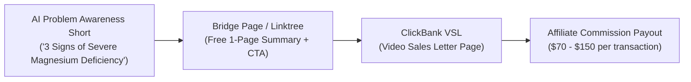

# Video 14: How I'd Go From $0 to $20K/Mo With ClickBank Using AI (Faceless)

- **Original Video Link:** [https://www.youtube.com/watch?v=C7S1pFt_DRM](https://www.youtube.com/watch?v=C7S1pFt_DRM)
- **Primary Business Model:** High-Ticket / High-Gravity Affiliate Marketing via Faceless AI Content
- **Target Audience:** Aspiring affiliate marketers, passive income seekers, beginners
- **Beginner Feasibility Rating:** 7/10 (High upside, zero product fulfillment required)
- **Speed to First Dollar:** 14 – 30 Days
- **Startup Capital Required:** $0 – $20 (Bridge page hosting / free tier tools)

---

## 1. Executive Summary & Core Premise
The video lays out an actionable framework to scale from zero to $20,000/month by combining ClickBank's highest-converting affiliate offers with organic, AI-generated short-form traffic. Instead of doing direct spam linking (which gets accounts instantly banned), the blueprint uses AI to create problem-awareness educational content on TikTok, Instagram Reels, and YouTube Shorts, routing viewers through a simple bridge landing page.

---

## 2. The 3 Evergreen ClickBank Niches
ClickBank products make money because they solve deep emotional or desperate human problems:
1. **Health & Weight Loss:** (E.g., Alpine ice hacks, gut microbiome supplements, natural joint relief). Average payout: $120–$180 per sale.
2. **Wealth & Make Money:** (Crypto trading bots, affiliate marketing courses). Average payout: $50–$300 per sale.
3. **Relationships & Manifestation:** (His Secret Obsession, Soulmate sketch, manifestation audio frequencies). Average payout: $30–$70 per sale.

---

## 3. The High-Converting Funnel Architecture

---

## 4. The "Noob" Reality Check (Brutal Truth & Red Flags)
- **Never Post Raw Affiliate Links:** TikTok, YouTube, and Meta will shadowban or terminate any account that places direct ClickBank hoplinks in bios or video descriptions. You MUST use a clean bridge page (Carrd.co, Beacons.ai, or Stan Store).
- **ClickBank Refund Rates:** Health supplements on ClickBank often carry 10% to 20% refund rates within 60 days, so net revenue will be lower than gross commissions shown in dashboards.

---

## 5. 7-Day Beginner Action Plan
- **Day 1:** Register a free affiliate account on ClickBank.com.
- **Day 2:** Go to the Marketplace, filter by "Gravity Score > 50" in the Health or Manifestation category. Select 1 high-converting offer with an average payout over $80.
- **Day 3:** Build a 1-page bridge landing page on Carrd.co (e.g., "The 30-Second Morning Tonic Recipe").
- **Day 4:** Use Claude to generate 10 scripts highlighting the physical symptom that the product treats.
- **Day 5:** Produce 5 vertical shorts using CapCut with stock wellness/kitchen footage and ElevenLabs voiceover.
- **Day 6:** Create dedicated TikTok and Instagram accounts; post 2 videos per day.
- **Day 7:** Track your hoplinks in your ClickBank analytics; optimize the first 3 seconds of the best-performing video.
