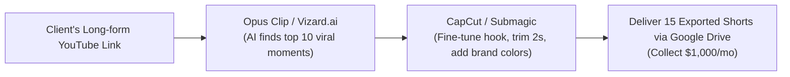

# Video 23: I Tried Fully Automating My Video Editing With AI (RAW RESULTS)

- **Original Video Link:** [https://www.youtube.com/watch?v=C0jOKDJtK9s](https://www.youtube.com/watch?v=C0jOKDJtK9s)
- **Primary Business Model:** Short-Form Video Repurposing Agency (Content Machine as a Service)
- **Target Audience:** Video editors, content creators, podcasters, agency freelancers
- **Beginner Feasibility Rating:** 8.5/10 (High market demand, accessible AI tooling)
- **Speed to First Dollar:** 7 – 14 Days
- **Startup Capital Required:** $0 – $30 (Opus Clip / Submagic free trial)

---

## 1. Executive Summary & Core Premise
The creator tests the leading AI video editing tools (Opus Clip, Submagic, Descript, Premiere Pro AI) to see if an entire long-form YouTube video or podcast can be edited autonomously without human intervention. The conclusion: while AI cannot craft a nuanced 30-minute narrative movie, it can execute 80% of the mechanical grunt work (clipping highlights, removing dead pauses, centering faces, auto-generating kinetic animated subtitles, and adding B-roll overlays).

---

## 2. The Freelance Offer: "Content Repurposing Agency"
Podcasters, CEOs, real estate agents, and coaches produce 1-hour long-form videos, interviews, and webinars every week, but they have zero time to cut them into TikToks, Reels, and YouTube Shorts.
- **The Service:** You take their 1 long-form YouTube video each week and turn it into **15 high-converting vertical Shorts** (3 videos posted per day across their channels).
- **The Pricing:** $750 to $1,500/month per creator.

---

## 3. The 30-Minute Production Workflow

---

## 4. The "Noob" Reality Check (Brutal Truth)
- If you simply download raw clips from Opus Clip and send them to the client without human touch, the client will fire you after month 1 because the AI often cuts off punchlines or chooses strange background B-roll.
- **Your Value Add:** You are the human editor who polishes the first 3 seconds, fixes misspelled subtitle words, and ensures the punchline lands cleanly. That 10 minutes of manual curation is why they pay you $1,000/month.

---

## 5. 7-Day Beginner Action Plan
- **Day 1:** Sign up for a free trial on **Opus Clip** and install **CapCut Desktop**.
- **Day 2:** Find an active business podcast on YouTube (e.g. real estate or local entrepreneurship).
- **Day 3:** Drop their latest 45-minute episode into Opus Clip; extract the 3 highest-scoring clips.
- **Day 4:** Spend 20 minutes in CapCut making the subtitles pop with yellow highlights, sound effects, and clean cut-ins.
- **Day 5:** Send the 3 finished, polished clips to the podcaster on Twitter or via email with a note:
  > *"Hey Dave, loved episode #45. I noticed you aren't posting vertical shorts on TikTok and Instagram Reels. I took the liberty of editing the top 3 moments for you—no strings attached, here is the Google Drive link to post them. If you'd like 20 of these every month, I'd love to handle it for you."*
- **Day 6:** Reach out to 10 podcasters using this exact sample-first method.
- **Day 7:** Sign your first recurring monthly editing retainer.
