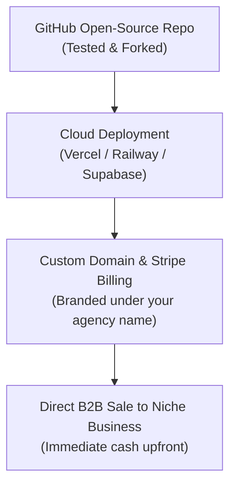

# Video 25: 8 GitHub Repos That Print Money (Part 2: Deep-Dive Implementation Guide)

- **Original Video Link:** [https://www.youtube.com/watch?v=eHljw6IG0sE](https://www.youtube.com/watch?v=eHljw6IG0sE) *(Note: Linked twice in user list; this file provides the actionable technical implementation layer for Video 07)*
- **Primary Business Model:** Open-Source Code Deployment & White-Label B2B Solutions
- **Target Audience:** Non-technical builders, aspiring tech entrepreneurs, technical freelancers
- **Beginner Feasibility Rating:** 6/10 (High utility; eliminates 90% of coding from scratch)
- **Speed to First Dollar:** 14 – 30 Days
- **Startup Capital Required:** $10 – $50 (Vercel / Railway / Supabase)

---

## 1. Executive Summary & Core Premise
While Video 07 highlighted the market viability of open-source repositories, this deep dive focuses on the **exact technical architecture and deployment pipeline** needed to take an open-source GitHub repository and turn it into a revenue-generating commercial tool without writing thousands of lines of custom code.

---

## 2. The 3 Repos With the Lowest Technical Barrier for Beginners

### A. The Document Question-Answering Wrapper (e.g. Quivr / Dify)
- **What it does:** Allows users to upload PDFs, manuals, and spreadsheets, creating a private ChatGPT trained on their company files.
- **The Monetization Angle:** Set this up as a private knowledge base for a local legal practice or accounting firm.
- **Deployment:** Deploy via **Railway.app** or **Vercel** with a 1-click button directly from the repo.
- **Client Price:** $1,000 setup + $150/mo hosting.

### B. Automated Background Removal (e.g. `rembg`)
- **What it does:** Uses a state-of-the-art open-source machine learning model to strip backgrounds from product images in milliseconds.
- **The Monetization Angle:** Package this as a bulk image cleaner for local car dealerships or secondhand luxury fashion sellers.
- **Client Price:** Charge $0.25 per processed car/product photo.

### C. Open-Source Form & Feedback Engines (e.g. Formbricks / Typebot)
- **What it does:** Self-hosted conversational forms with zero response limits.
- **The Monetization Angle:** White-label it as an interactive patient onboarding questionnaire for dental clinics and wellness spas.
- **Client Price:** $300 setup fee.

---

## 3. The 4-Step Commercialization Stack

---

## 4. The "Noob" Trap to Avoid
Never try to compete with massive VC-backed SaaS products like Canva or Zapier on general features. You win by **hyper-specializing**:
- Do not sell: "An AI background remover app".
- Sell: "The Automated Inventory Photo Optimizer for Local Used Car Dealerships in Ohio".
