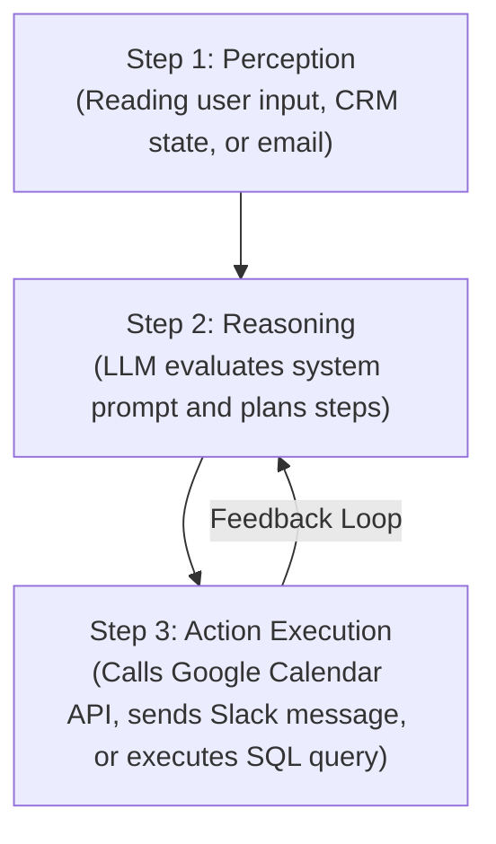

# Video 26: Build Your Own AI Agent in 3 Steps (Notion Co-Founder Explains)

- **Original Video Link:** [https://www.youtube.com/watch?v=nAkfg5TUBKk](https://www.youtube.com/watch?v=nAkfg5TUBKk)
- **Primary Business Model:** Autonomous AI Agent Architecture & Internal Automation Tooling
- **Target Audience:** Engineers, product managers, technical founders, systems thinkers
- **Beginner Feasibility Rating:** 4.5/10 (High intellectual value; medium-high technical threshold)
- **Speed to First Dollar:** 30 – 60 Days
- **Startup Capital Required:** $0 – $20 (OpenAI / Anthropic API credits)

---

## 1. Executive Summary & Core Premise
In this video, a foundational tech leader (Notion Co-founder / systems architect) demystifies what autonomous "AI Agents" actually are under the hood. Beyond the buzzwords, an AI agent is simply an LLM equipped with a decision loop, contextual memory, and a set of executable tools (APIs/functions). The video breaks agent development down into 3 fundamental components: **Perception (Context/Inputs)**, **Reasoning (Decision-Making Planning)**, and **Action (Tool Calling / Webhooks)**.

---

## 2. The 3 Steps to Building an Agent

1. **Perception (Context & State):** Giving the agent access to structured data (user intent, database rows, documents).
2. **Reasoning (Planning & Decision Matrix):** Instructing the model to break high-level objectives into sequential micro-steps.
3. **Action (Tool Execution):** Granting the model permission to invoke specific functions (e.g. `check_calendar()`, `send_email()`, `query_database()`).

---

## 3. How a Beginner Converts This Theory Into Practical Value
While writing raw autonomous agent loops in LangChain or AutoGen from scratch can be overwhelming for a beginner, you can build practical, client-ready AI agents using visual platforms:
- **Flowise AI / Langflow:** Drag-and-drop node builders that let you build tool-using agents visually.
- **Make.com / n8n:** Connect AI reasoning directly to 1,000+ business apps without writing custom Python execution loops.

---

## 4. The "Noob" Reality Check (Brutal Truth)
- Autonomous agents can get stuck in infinite execution loops or hallucinate tool parameters if prompts lack strict guardrails.
- Always implement **deterministic boundary checks**: do not allow an AI agent to execute payments or send public emails without human confirmation.
- Focus first on building **single-step automations** before attempting multi-agent autonomous swarms.
