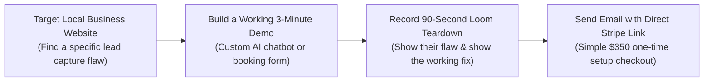

# Video 27: How to Start an AI Agency in 30 Days and Get Clients (No Sales Calls)

- **Original Video Link:** [https://www.youtube.com/watch?v=CiJYpw_oU40](https://www.youtube.com/watch?v=CiJYpw_oU40)
- **Primary Business Model:** Asynchronous B2B AI Consulting / "Demo-First" Client Acquisition
- **Target Audience:** Introverted founders, beginners, freelancers who hate cold calling
- **Beginner Feasibility Rating:** 9/10 (One of the most practical client acquisition strategies available)
- **Speed to First Dollar:** 7 – 14 Days
- **Startup Capital Required:** $0 – $20 (Loom account / free screen recorder)

---

## 1. Executive Summary & Core Premise
Most agency beginners fail because they panic during live high-pressure phone sales calls or Zoom presentations. This video presents a complete, battle-tested system for closing high-ticket B2B AI agency clients **without ever hopping on a live sales call**. The strategy uses an **Asynchronous Audit & Interactive Demo Pipeline**: building a working prototype first, recording a personalized 2-minute video teardown, and closing clients via email and Stripe invoices.

---

## 2. The "No Sales Call" Client Acquisition Funnel

---

## 3. The 90-Second Loom Script That Closes Without Calls
1. **Seconds 0–20 (The Flaw):**
   > *"Hey Dr. Roberts, was looking at your dental clinic's website. I noticed when a patient visits at 8:00 PM on Sunday, their only option is to fill out a static form and wait until Monday at 9:00 AM for a reply. By then, half of them have called another emergency dentist."*
2. **Seconds 20–60 (The Live Working Fix):**
   > *"I actually took 15 minutes and built an interactive AI booking assistant customized with your dental pricing and insurance FAQs right here [click on screen and show bot answering questions accurately]."*
3. **Seconds 60–90 (The Frictionless Offer):**
   > *"You can test it out yourself right here at this link. If you want this embedded on your website, it's just a one-time $350 setup. Just reply 'yes' and I will send over the embed code today. If not, no worries at all!"*

---

## 4. The Math for a Beginner
- Send 15 personalized Loom pitches per day (Takes ~2 hours).
- In 5 days = 75 targeted business owners reached.
- Average response rate: 8% (6 replies).
- Close 2 to 3 clients = **$700 to $1,050 earned in your first 10 days**.

---

## 5. 7-Day Beginner Action Plan
- **Day 1:** Set up a free account on **Voiceflow** or **Chatbase**.
- **Day 2:** Build 1 standard template bot for an urgent local niche (Dentists, Roofers, or Auto Repair).
- **Day 3:** Find 30 businesses with great Google reviews but broken/missing live chat.
- **Day 4:** Record and send 10 personalized Loom teardowns.
- **Day 5:** Record and send 10 more Loom teardowns. Follow up on Day 4 views.
- **Day 6:** Answer questions via email/text.
- **Day 7:** Send a Stripe payment link to your first closed customer.
